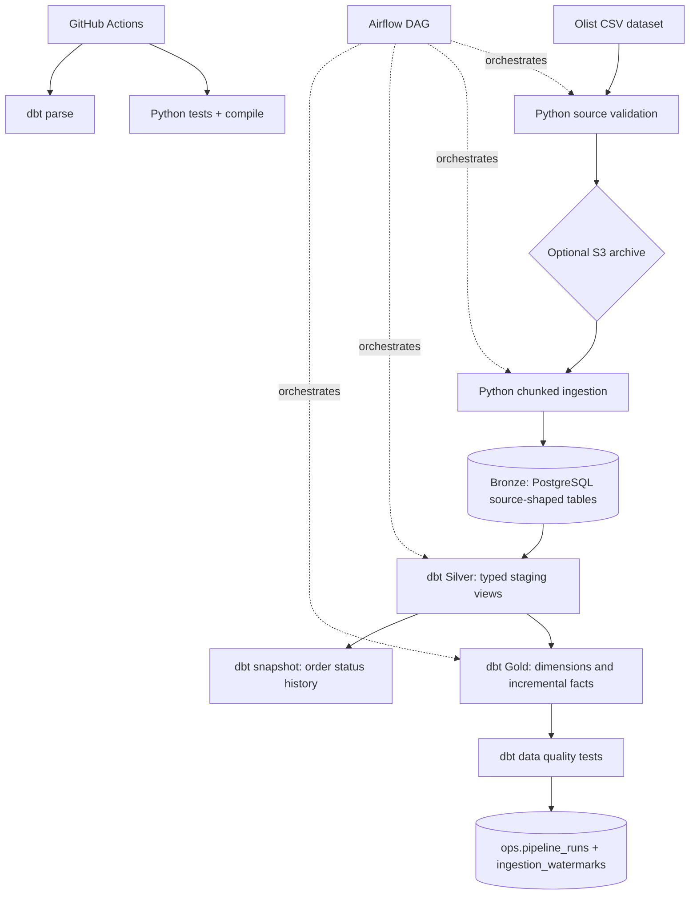

# Olist E-Commerce Data Platform — Version 2

A portfolio-grade batch Data Engineering project using the Brazilian E-Commerce Public Dataset by Olist. The project demonstrates source validation, file-level incremental ingestion, a PostgreSQL medallion architecture, dbt transformations, data quality tests, Airflow orchestration, optional S3 archival, and CI.

> **Honesty note:** This repository contains implementation code and tests. Do not claim a successful end-to-end run, cloud deployment, production SLA, or measured performance until you have run and verified those things in your own environment.

## Architecture



### Medallion layers

| Layer | PostgreSQL schema | Purpose |
|---|---|---|
| Bronze | `bronze` | Source-shaped tables loaded from Olist CSVs |
| Silver | `silver` | Typed, standardized dbt views and order-status snapshot |
| Gold | `gold` | Analytics-ready dimensions and facts |
| Operations | `ops` | File fingerprints, ingestion watermarks and pipeline run metrics |

dbt's custom `generate_schema_name` macro is located in the correct dbt project macro directory and deliberately maps custom schemas to their exact names (`silver`, `gold`) instead of creating names such as `public_gold`.

## Technology stack

- Python 3.11, pandas, SQLAlchemy
- PostgreSQL 16
- dbt Core 1.9 + dbt-postgres
- Apache Airflow 2.10
- Docker Compose
- AWS S3 via boto3 (optional)
- MinIO for local S3-compatible testing (optional)
- pytest and GitHub Actions

## Dataset setup

Download the Brazilian E-Commerce Public Dataset by Olist:
https://www.kaggle.com/datasets/olistbr/brazilian-ecommerce

Extract the nine CSVs into `data/raw/`:

- `olist_customers_dataset.csv`
- `olist_geolocation_dataset.csv`
- `olist_order_items_dataset.csv`
- `olist_order_payments_dataset.csv`
- `olist_order_reviews_dataset.csv`
- `olist_orders_dataset.csv`
- `olist_products_dataset.csv`
- `olist_sellers_dataset.csv`
- `product_category_name_translation.csv`

Do not commit the raw CSVs to GitHub. The dataset is provided under CC BY-NC-SA 4.0; review its terms before reuse and attribute Olist.

## Run locally on Windows

Prerequisites:
- Docker Desktop (Linux containers enabled)
- Git
- Kaggle account for dataset download

### 1. Extract and configure

```powershell
cd olist-data-engineering
Copy-Item .env.example .env
```

Edit `.env`. For a simple local setup, use the same password for `POSTGRES_PASSWORD` and `WAREHOUSE_PASSWORD`. Change all example credentials before sharing the environment. Never commit `.env`.

### 2. Add the dataset

Put the nine CSV files listed above into `data/raw/`.

### 3. Build and start

```powershell
docker compose up --build -d
docker compose ps
```

Services:
- Airflow UI: http://localhost:8080
- PostgreSQL from host: `localhost:5433`
- PostgreSQL inside Compose: `warehouse:5432`

Local Airflow credentials are the values in `.env` (`admin` and the configured password).

### 4. Trigger the DAG

In Airflow, open `olist_ecommerce_pipeline`, unpause it, and trigger a run. The task order is:

1. `validate_source_files`
2. `optional_archive_to_s3` (skips if `S3_BUCKET` is empty)
3. `load_bronze_incrementally`
4. `dbt_run_silver_gold`
5. `dbt_snapshot_order_status`
6. `dbt_data_quality_tests`

### 5. Inspect results

Connect to PostgreSQL using a client or `psql` and inspect:

```sql
select * from ops.ingestion_watermarks order by source_name;
select * from ops.pipeline_runs order by started_at desc;
select count(*) from bronze.orders;
select count(*) from silver.stg_orders;
select count(*) from gold.fct_orders;
select * from gold.fct_orders limit 10;
```

Run analytical examples in `sql/analytics_questions.sql` and operational checks in `sql/pipeline_observability.sql`.

## Incremental and idempotent behavior

### Python ingestion watermark

Each source file is SHA-256 fingerprinted. The fingerprint, filename, row count, load time, and status are stored in `ops.ingestion_watermarks`.

- Same file hash + prior successful load: skip the file.
- New or changed hash: load chunks into a temporary Bronze table, then swap it into place and update the watermark in a database transaction.
- Failed load: remove the temporary table, record failure, and raise the error so Airflow can retry.

This is **file-level incremental ingestion for immutable/snapshot CSV sources**, not row-level CDC. If a source CSV changes, the complete affected source table is replaced to avoid missing deletes or updates.

### dbt incremental facts

`gold.fct_orders` and `gold.fct_order_items` are incremental models using a configurable event-time lookback (30 days by default, overridden with the dbt var `incremental_lookback_days`) and `delete+insert` semantics keyed by order ID / order-item grain. This supports repeatable runs and late-arriving updates within the lookback.

If historical data changes outside the 30-day window, run a controlled full refresh:

```bash
docker compose exec airflow-webserver bash -lc \
  "dbt run --full-refresh --project-dir /opt/airflow/dbt/olist_warehouse --profiles-dir /opt/airflow/dbt/olist_warehouse"
```

Then rerun dbt tests and snapshots. Override the default with `--vars '{"incremental_lookback_days": 60}'`. The lookback is an engineering trade-off, not a guarantee of unlimited historical change capture.

## Optional S3 integration

### Real AWS S3

1. Create a private S3 bucket.
2. Use an IAM user/role with only the required `s3:PutObject` permission on the target bucket prefix.
3. Set `S3_BUCKET`, `S3_PREFIX`, `AWS_DEFAULT_REGION`, and credentials in `.env`.
4. Restart Airflow services and trigger the DAG.

Prefer IAM roles or a secrets manager for shared/cloud environments. Do not commit AWS keys.

### Local S3-compatible test with MinIO

Start MinIO:

```powershell
docker compose --profile local-s3 up -d minio
```

Open http://localhost:9001 and sign in with:
- User: `minioadmin`
- Password: `minioadmin_local_only`

Create a bucket named `olist-local`. Set these values in `.env`:

```dotenv
S3_BUCKET=olist-local
S3_PREFIX=olist/bronze/source_files
AWS_ACCESS_KEY_ID=minioadmin
AWS_SECRET_ACCESS_KEY=minioadmin_local_only
S3_ENDPOINT_URL=http://minio:9000
AWS_DEFAULT_REGION=us-east-1
```

Restart the Airflow services:

```powershell
docker compose up -d --force-recreate airflow-init airflow-webserver airflow-scheduler
```

The MinIO endpoint is `http://minio:9000` from inside Docker Compose. If running the Python S3 script directly on the host, use `http://localhost:9000`.

## Local Python tests without Docker

Use Python 3.11 (the Docker/CI runtime) for the closest match:

```powershell
py -3.11 -m venv .venv
.venv\Scripts\Activate.ps1
pip install -r requirements.txt
$env:PYTHONPATH = "src"
pytest -q
python -m compileall -q src dags
```

The unit tests do not require the Olist dataset or a running PostgreSQL server. Full integration requires both.

## Repository structure

```text
.
├── .github/workflows/ci.yml
├── dags/                         # Airflow orchestration
├── dbt/olist_warehouse/
│   ├── macros/                   # exact custom schema naming
│   ├── models/staging/            # Silver views
│   ├── models/marts/              # Gold dimensions and facts
│   ├── snapshots/                 # order status history
│   └── tests/                     # business-rule tests
├── docker/init/                   # create Airflow metadata DB
├── data/raw/                      # local Olist files (not committed)
├── docs/                          # architecture, dictionary, interview guide
├── sql/                           # analytics and operational SQL
├── src/olist_pipeline/            # validation, ingestion, S3 archive
├── tests/                         # Python unit tests
├── docker-compose.yml
└── Dockerfile.airflow
```

## Resume bullets — only after successful local validation

**Olist E-Commerce Data Platform | Python, SQL, PostgreSQL, Airflow, dbt, Docker, AWS S3**

- Built a batch data pipeline to validate and ingest nine related e-commerce CSV sources into PostgreSQL Bronze tables using chunked Python processing and SHA-256 file watermarks.
- Developed dbt Silver staging views and Gold dimensional models, including incremental order and order-item facts with a configurable event-time lookback.
- Orchestrated ingestion, optional object-storage archival, transformations, snapshots, and data quality checks using Apache Airflow and Docker Compose.
- Added operational metadata tables, retry handling, Python unit tests, dbt business-rule tests, and GitHub Actions CI.

Remove AWS S3 from the skills/bullet unless you have successfully tested the integration against AWS or MinIO. Do not state production deployment or performance improvements without evidence.

## Troubleshooting

See `docs/troubleshooting.md` for common Docker, Airflow, dbt, dataset, credentials, and incremental-load issues.
