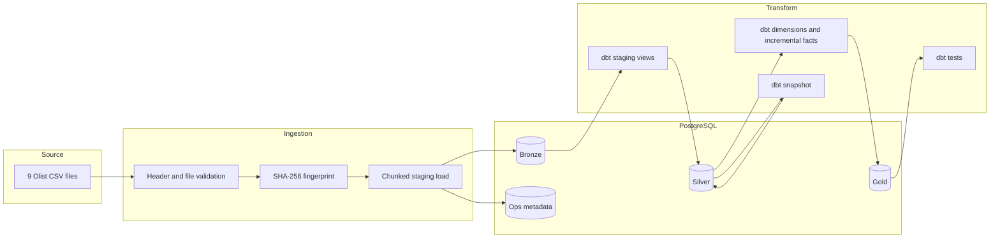

# Architecture and engineering decisions

## Data flow

## Layer responsibilities

- **Bronze:** source-shaped CSV tables. Python validates source headers and uses chunked loading.
- **Silver:** typed dbt views; normalized city/state casing, numeric values and timestamps.
- **Gold:** analytics-ready star-schema dimensions and facts.
- **Ops:** ingestion file hashes, row counts, statuses and pipeline run history.

## Grain and fact modelling

| Model | Grain | Natural key |
|---|---|---|
| `gold.dim_customers` | One Olist customer record | `customer_id` |
| `gold.dim_products` | One product | `product_id` |
| `gold.dim_sellers` | One seller | `seller_id` |
| `gold.fct_orders` | One order | `order_id` |
| `gold.fct_order_items` | One line item | (`order_id`, `order_item_id`) |

Payment rows and order-item rows are both one-to-many against orders. Joining both raw child tables directly multiplies rows and overstates measures. The order fact independently aggregates each child table to order grain before joining to orders.

## Idempotency and recovery

1. A source file's SHA-256 hash is compared with its last successful watermark.
2. Unchanged files are skipped.
3. Changed files load into a temporary table in chunks.
4. The old Bronze table is replaced by the new table in a transaction, together with the successful watermark update.
5. Failed attempts remove the temporary table, record a failed watermark, and raise an exception for Airflow retries.

This design is suitable for a fixed public CSV snapshot. It is not a general CDC framework. For continuously changing production sources, use source event IDs, update timestamps, or CDC logs and perform row-level merge/upsert.

## Incremental transformation

The Gold facts use `delete+insert` keyed by their grain and a 30-day event-time lookback. This refreshes recent orders to handle late-arriving changes within the lookback. Older corrections require a full refresh or a backfill strategy.

## Snapshot

`orders_status_snapshot` uses dbt's check strategy to preserve changes in order status and delivery timestamps across runs. The supplied public dataset is a static snapshot, so historical transitions will only appear if source rows change between executions. The snapshot does not invent historical events that are absent from the source.

## Orchestration and observability

Airflow runs validation, optional S3 archival, Bronze ingestion, dbt models, dbt snapshots and tests in dependency order. Retries use exponential backoff. Python writes run-level and file-level metadata into `ops`.

## Security boundaries

Local credentials in `.env.example` are placeholders. Do not commit `.env`, AWS keys, or production secrets. For cloud use, prefer IAM roles, a secrets manager, network restrictions, TLS and least-privilege database roles.

## Future production extensions

- CDC or API ingestion with row-level upserts.
- Configurable source-specific watermarks and backfills.
- S3 lifecycle policies and partitioned Parquet storage.
- dbt exposures, semantic metrics and source freshness.
- Alerting to Slack/email and pipeline SLA monitoring.
- Separate database roles for ingestion, transformation and read-only analytics.
- Integration tests in ephemeral PostgreSQL containers.
